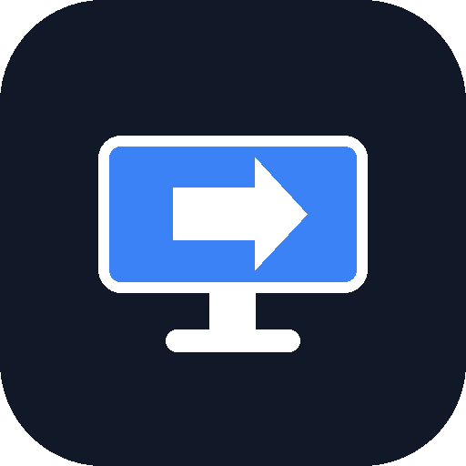
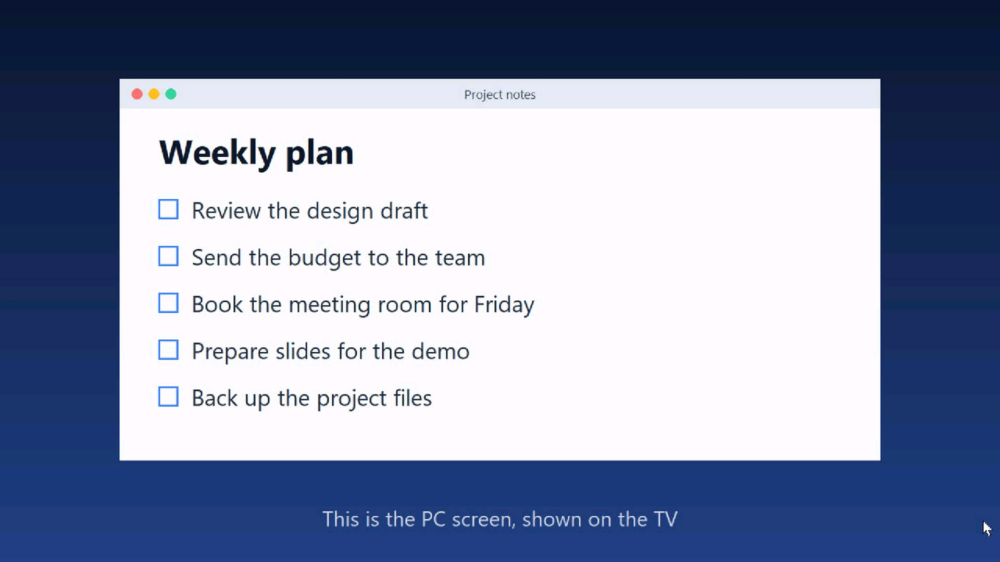
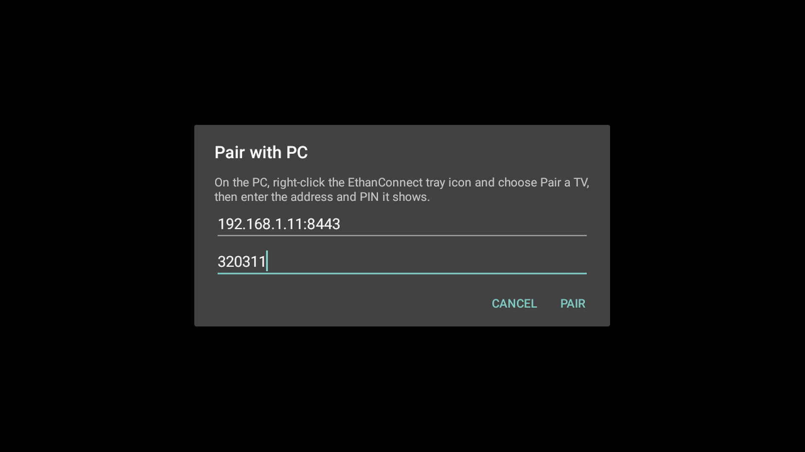
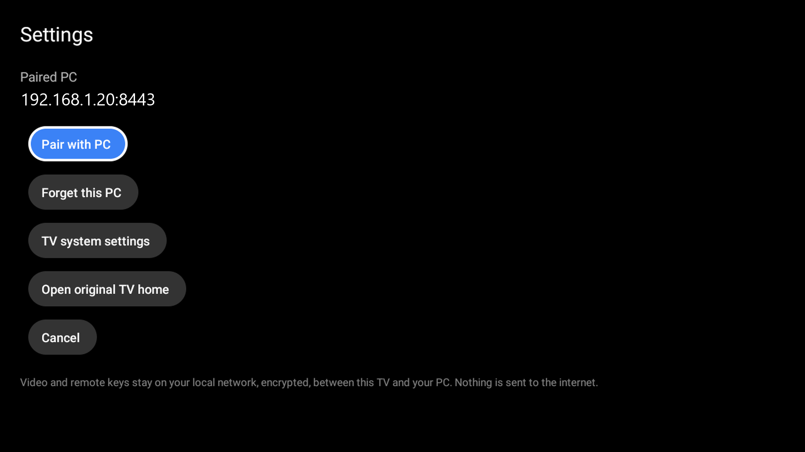
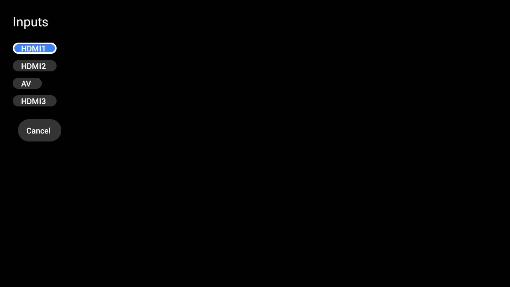
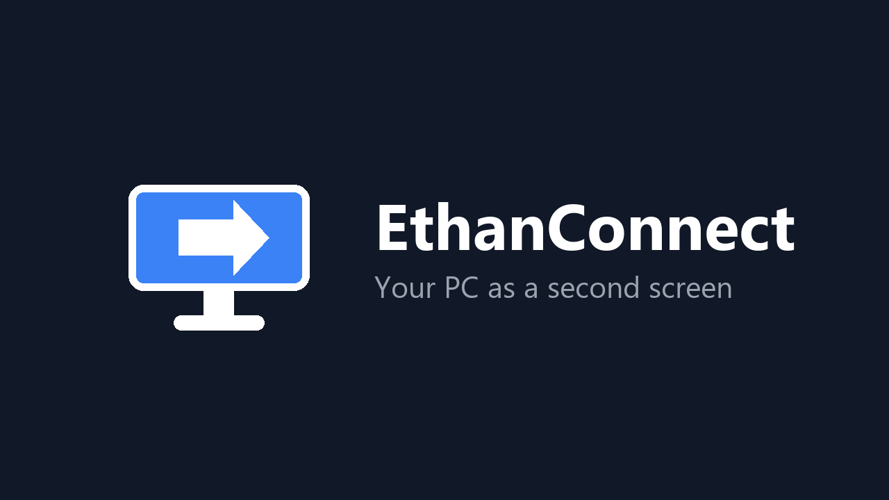

<p align="center">
  
  <h1 align="center">EthanConnect</h1>
  <p align="center">
    <b>Turn any Android TV into a wireless second monitor for your Windows PC.</b><br/>
    Control with your TV remote or phone, streamed over your local network — no cloud, no accounts, no ads.
  </p>
</p>

<p align="center">
  <a href="https://github.com/danyjoeisawesome-svg/EthanConnect/releases"></a>
  
  
  <a href="LICENSE"></a>
</p>

<p align="center">
  <a href="https://github.com/danyjoeisawesome-svg/EthanConnect/releases"><b>⬇️ Download Windows Client (.exe)</b></a> &nbsp;•&nbsp; 
  <a href="https://github.com/danyjoeisawesome-svg/EthanConnect/releases"><b>📱 Download Android TV App (.apk)</b></a> &nbsp;•&nbsp; 
  <a href="#quick-start"><b>🚀 Quick Start</b></a> &nbsp;•&nbsp; 
  <a href="#why-ethanconnect"><b>⚖️ Why EthanConnect?</b></a>
</p>

---

<p align="center">
  
</p>

---

## ✨ Features

- 🖥️ **Real Extended Display:** Use a true virtual second monitor on Windows (`Extend desktop`), not just mirror mode.
- 🎯 **TV Remote as Mouse:** Control the PC directly using your TV remote. D-pad moves the mouse cursor, `OK` clicks, hold `OK` right-clicks, and `CH+`/`CH-` scrolls.
- 📱 **Instant Phone Companion (Zero-Install):** Scan a QR code from the PC tray to turn any phone browser into an ultra-responsive touchpad and keyboard.
- 🔒 **100% Local & Private:** TLS-encrypted communication with SHA-256 certificate pinning and a 6-digit one-time PIN. No telemetry, no external servers, no account logins.
- ⚡ **Auto-Discovery:** Automatic local UDP network discovery—your TV finds your PC automatically without manually typing IP addresses.
- 🎨 **Lightweight TV Launcher & Screensaver:** Includes a clean Leanback launcher, custom wallpaper/screensaver picker, and an HDMI/AV input switcher.

---

## ⚖️ Why EthanConnect?

| Feature | EthanConnect | Spacedesk | Moonlight / Sunshine | Chromecast / Miracast |
|---|:---:|:---:|:---:|:---:|
| **License** | **Open Source (MIT)** | Proprietary | Open Source | Proprietary |
| **Cloud / Accounts** | **None (100% Local)** | None | None | Requires Google Account |
| **TV Remote Mouse** | **Native D-pad Control** | ❌ No | ⚠️ Gamepad only | ❌ No |
| **Phone Trackpad** | **Built-in QR (No App Needed)** | ❌ Separate App | ❌ No | ❌ No |
| **Extended Desktop** | **Yes (Virtual Display Driver)** | Yes | ⚠️ Complex dummy plug setup | ❌ Mirroring only |
| **Ads / Paywalls** | **100% Free & No Ads** | Free tier restrictions | 100% Free | Ads in Chromecast UI |

---

## 📸 Screenshots

<p align="center">
  
  &nbsp;&nbsp;
  
</p>
<p align="center">
  
  &nbsp;&nbsp;
  
</p>

---

## 🏗️ Architecture

```text
 Windows PC (EthanConnect PC)  <--- Wi-Fi / LAN (TLS) --->  Android TV (EthanConnect)
   capture monitor (MJPEG)      ─────────────────────────▶   shows screen full-screen
   mouse / keyboard injection   ◀─────────────────────────   remote keys (D-pad = mouse, OK = click)
        ▲
        └──── Phone browser: /remote (trackpad + keyboard) & /view (mirror)
```

---

<a name="quick-start"></a>
## 🚀 Quick Start

### 1. Windows PC
1. Download and run **[EthanConnect-Setup.exe](https://github.com/danyjoeisawesome-svg/EthanConnect/releases)** on your Windows 10/11 PC.
2. The control window will open showing a 6-digit pairing PIN and a QR code.
3. *(Optional for a true second monitor):* Right-click the system tray icon > **Set up second screen**. This installs the signed virtual display driver. Set Windows Display settings to **Extend**.

### 2. Android TV
1. Install **EthanConnect** on your TV (via Play Store or [sideload the release APK](https://github.com/danyjoeisawesome-svg/EthanConnect/releases)).
2. Open **Second Screen** > **Pair with PC**.
3. Select your PC (auto-discovered on the local network) and enter the 6-digit PIN.
4. Your PC screen is now streamed to your TV!

### 3. Phone Companion (Optional)
* Simply scan the QR code displayed in the PC pairing window with your phone camera.
* Your phone browser opens a low-latency touchpad and virtual keyboard. No app installation required!

### Remote Control Shortcuts
* **D-Pad:** Move mouse cursor
* **OK Button:** Left-click
* **Hold OK Button:** Right-click
* **CH+ / CH-:** Scroll up / down
* **Back:** Exit second screen
* **Menu:** Re-pair / TV settings

---

## 🔒 Security Model

* **TLS with Self-Signed Certificate:** Generated uniquely on your PC on first run.
* **Certificate Pinning:** The TV pins the SHA-256 fingerprint during pairing and rejects any unknown certificate.
* **PIN Authentication:** Pairing requires a one-time 6-digit PIN (5-minute expiry, 5 max attempts). The TV authenticates using `HMAC(PIN, fingerprint)`.
* **Zero Cloud Exposure:** The PC server only binds to your local network (TCP 8443) and broadcasts discovery on local UDP 8082. Nothing ever leaves your LAN.

---

## 🛠️ Project Structure

| Directory | Description | Build Output |
|---|---|---|
| [`android/`](android/) | Android TV client & optional Leanback launcher (`com.ethanconnect.tv`) | `EthanConnect.apk` / `app-release.aab` |
| [`pc/`](pc/) | Windows tray application (TLS server, input injection, virtual display helper) | `dist/EthanConnect.exe` |
| [`installer/`](installer/) | Inno Setup 6 installer script | `dist/EthanConnect-Setup-1.0.0.exe` |
| [`store/`](store/) | Play Store metadata, graphics generators, screenshots | Store banners & listings |
| [`docs/`](docs/) | Documentation & Privacy Policy (GitHub Pages) | Public documentation |

---

## 💻 Building from Source

### TV App (JDK 17+ and Android SDK API 34)
```powershell
cd android
.\gradlew.bat assembleDebug                      # Debug APK
.\gradlew.bat bundleRelease assembleRelease      # Release bundle (requires keystore.properties)
```

### PC Client (Python 3.9+)
```powershell
pip install pyinstaller pystray cryptography pillow mss qrcode
cd pc
pyinstaller --noconfirm --clean --onefile --noconsole --name EthanConnect-1.2.1 --icon ..\pc\ethanconnect.ico `
  --version-file ..\pc\version_info.txt --add-data "..\pc\ethanconnect.ico;." --hidden-import web_pages `
  --hidden-import pystray._win32 --distpath dist\release --workpath build_pyi\EthanConnect-1.2.1 `
  --specpath build_pyi pc\ethanconnect_pc.py
```

### Windows Installer (Inno Setup 6)
```powershell
iscc installer\EthanConnect.iss
```

---

### Add Custom Wallpaper or Screensaver Images
1. Place a 16:9 landscape JPEG into `android/app/src/main/res/drawable-nodpi/` named `wallpaper_<id>.jpg` (e.g., `wallpaper_aurora.jpg`).
2. Add a display name in `android/app/src/main/res/values/strings.xml`: `<string name="wallpaper_name_aurora">Aurora</string>`.
3. Add the ID to the `wallpaper_options` list in `android/app/src/main/res/values/wallpapers.xml`: `<item>aurora</item>`.
4. Rebuild the app.

---

## 🤝 Contributing

Contributions, bug reports, and feature requests are welcome!
Feel free to check out the [issues page](https://github.com/danyjoeisawesome-svg/EthanConnect/issues) or submit a Pull Request.

---

## 📜 License

Distributed under the **MIT License**. See [`LICENSE`](LICENSE) for more information.

*Notice:* The optional virtual display driver (`usbmmidd`) is a product by Amyuni Technologies, downloaded on demand during setup and is not redistributed within this repository.
